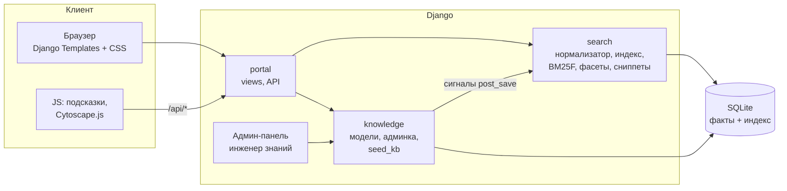
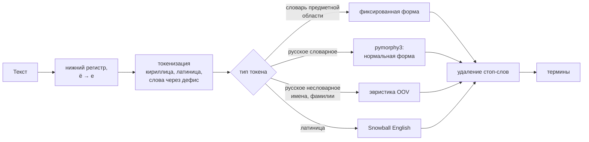
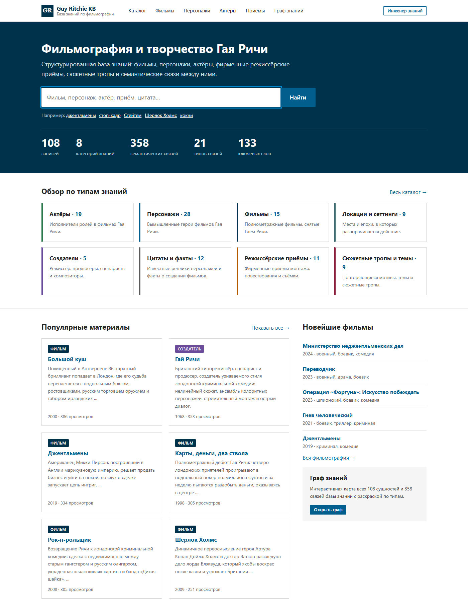
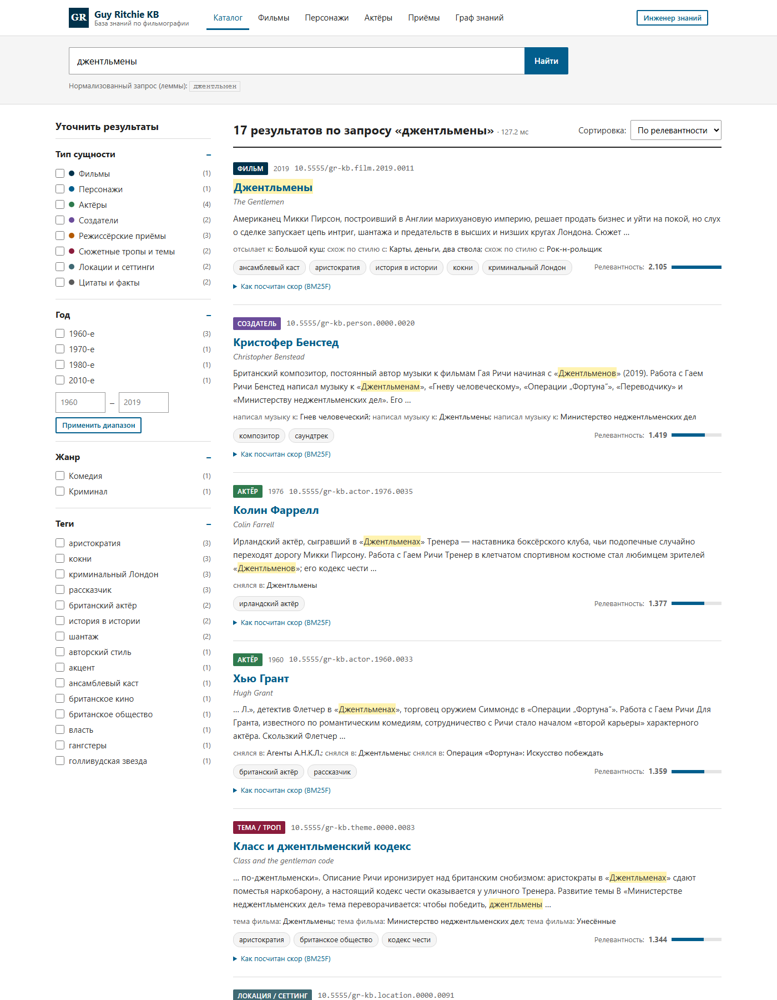
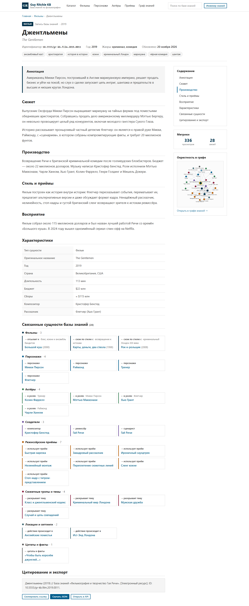
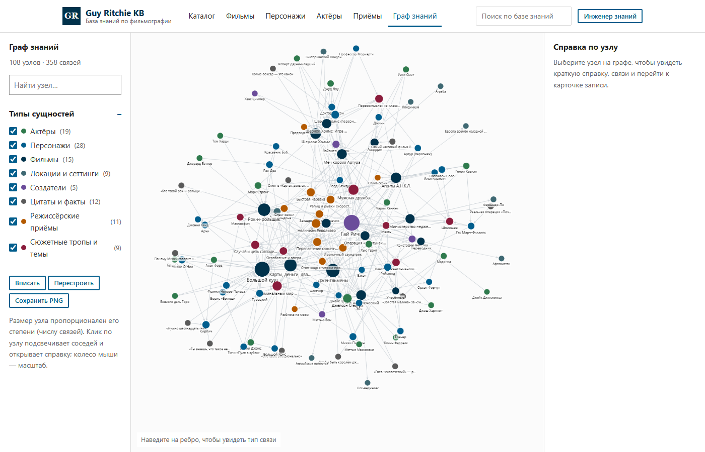

# Отчёт по курсовой работе

**Дисциплина:** Базы знаний
**Тема:** Разработка веб-приложения «База знаний по фильмографии и творчеству Гая Ричи»
**Стек:** Python 3.14 · Django 6.0 · SQLite · pymorphy3 · Cytoscape.js

---

## Содержание

1. [Введение](#1-введение)
2. [Анализ предметной области](#2-анализ-предметной-области)
3. [Модель представления знаний](#3-модель-представления-знаний)
4. [Архитектура приложения](#4-архитектура-приложения)
5. [Поисковый модуль](#5-поисковый-модуль)
6. [Пользовательский интерфейс](#6-пользовательский-интерфейс)
7. [Программный интерфейс (REST API)](#7-программный-интерфейс-rest-api)
8. [Наполнение базы знаний](#8-наполнение-базы-знаний)
9. [Тестирование и экспериментальная проверка](#9-тестирование-и-экспериментальная-проверка)
10. [Ограничения и направления развития](#10-ограничения-и-направления-развития)
11. [Заключение](#11-заключение)
12. [Список источников](#12-список-источников)
13. [Приложение А. Запуск проекта](#приложение-а-запуск-проекта)
14. [Приложение Б. Структура проекта](#приложение-б-структура-проекта)

---

## 1. Введение

Фильмы Гая Ричи образуют плотную сеть повторяющихся элементов: одни и те же актёры
переходят из фильма в фильм, фирменные приёмы (нелинейный монтаж, стоп-кадры с
титрами, переплетение сюжетных линий) кочуют между жанрами, а темы и тропы
(криминальный Лондон, мужская дружба, макгаффин) связывают ранние и поздние работы.
Такая предметная область естественно описывается не таблицей, а **графом знаний**:
важны не столько отдельные факты, сколько связи между ними.

**Цель работы** — спроектировать и реализовать веб-приложение, которое хранит знания
о творчестве Гая Ричи в виде семантической сети, обеспечивает полнотекстовый поиск
с ранжированием и фасетной фильтрацией и визуализирует связи между сущностями.

**Задачи:**

1. Проанализировать предметную область и выделить классы сущностей и типы связей.
2. Спроектировать модель представления знаний (онтологию) и схему базы данных.
3. Реализовать интерфейс инженера знаний для ввода и редактирования фактов.
4. Разработать собственный модуль индексации и полнотекстового поиска с поддержкой
   морфологии русского языка и весами полей.
5. Реализовать фасетную фильтрацию, сортировку, подсветку и сниппеты.
6. Разработать веб-интерфейс в академическом стиле (ориентир — портал SpringerLink)
   и интерактивную визуализацию графа.
7. Предоставить REST API для доступа к данным.
8. Наполнить базу знаний содержательными данными и проверить работу системы тестами.

---

## 2. Анализ предметной области

Объект моделирования — фильмография Гая Ричи (1998–2024) и связанные с ней знания.
В ходе анализа выделены следующие классы сущностей:

| Класс | Примеры | Ключевые атрибуты |
|---|---|---|
| Фильм | «Большой куш», «Джентльмены» | год, жанры, бюджет, сборы, длительность, первоисточник |
| Персонаж | Турецкий, Кирпич, Микки Пирсон | исполнитель, род занятий, функция в сюжете |
| Актёр | Джейсон Стейтем, Хью Грант | дата и место рождения, награды |
| Создатель | Гай Ричи, Мэттью Вон, Ханс Циммер | роль в съёмочной группе |
| Киноприём | нелинейный монтаж, рапид | категория приёма, синонимы |
| Тема / троп | макгаффин, месть, мужская дружба | тип (тема, троп, жанр) |
| Локация / сеттинг | Ист-Энд, викторианский Лондон | эпоха, реальная или вымышленная |
| Цитата / факт | «Ты знаешь, что такое немезида?» | говорящий, тип факта |

Отношения между сущностями разнородны: «актёр *снялся в* фильме», «актёр *исполнил
роль* персонажа», «фильм *использует приём*», «персонаж *воплощает тему*», «фильм
*схож по стилю с* фильмом». Часть отношений симметрична, у части есть естественное
обратное прочтение («снялся в» ↔ «в ролях»). Эти наблюдения определили выбор модели.

---

## 3. Модель представления знаний

### 3.1. Выбор модели

Выбрана **семантическая сеть** — ориентированный граф с типизированными вершинами
и типизированными рёбрами. Альтернативы и причины отказа:

| Модель | Почему не выбрана как основная |
|---|---|
| Продукционная (правила «если — то») | Предметная область описательная, а не процедурная: нужно хранить факты и связи, а не выводить решения |
| Фреймовая | Хорошо описывает атрибуты сущности, но связи между фреймами менее выразительны; фреймовый аспект частично сохранён через `metadata_json` |
| Реляционная таблица фактов | Требует отдельной таблицы под каждый тип отношения; добавление нового типа связи меняет схему |

В реализованной модели **онтология (классы и предикаты) хранится как данные**, а не как
схема БД: новый тип сущности или связи добавляется через админ-панель без миграций.

### 3.2. Онтология

**Классы сущностей** (`EntityType`): 8 классов, у каждого — код, название, цвет
(используется в бейджах и на графе) и порядок вывода.

**Типы связей** (`RelationType`): 21 предикат. У каждого есть прямое и обратное имя,
поэтому одна запись связи корректно читается с обеих сторон.

| Код | Прямое имя | Обратное имя | Домен → диапазон |
|---|---|---|---|
| `directed` | снял фильм | режиссёр | Создатель → Фильм |
| `produced` | продюсер фильма | продюсер | Создатель → Фильм |
| `wrote` | соавтор сценария | сценарист | Создатель → Фильм |
| `composed` | написал музыку к | композитор | Создатель → Фильм |
| `acted_in` | снялся в | в ролях | Актёр → Фильм |
| `played` | исполнил роль | исполнитель роли | Актёр → Персонаж |
| `character_of` | персонаж фильма | персонажи | Персонаж → Фильм |
| `uses_technique` | использует приём | использован в фильме | Фильм → Киноприём |
| `explores_theme` | раскрывает тему | тема фильма | Фильм → Тема |
| `embodies` | воплощает тему | воплощена в персонаже | Персонаж → Тема |
| `set_in` | действие происходит в | место действия фильма | Фильм → Локация |
| `similar_style` | схож по стилю с | *(симметричная)* | Фильм ↔ Фильм |
| `sequel_of` | продолжение фильма | имеет продолжение | Фильм → Фильм |
| `references` | отсылает к | упоминается в | любая → любая |
| `related_technique` | связан с приёмом | *(симметричная)* | Приём ↔ Приём |
| `quote_from` | цитата из фильма | цитаты и факты | Цитата → Фильм |
| `said_by` | реплика персонажа | автор реплики | Цитата → Персонаж |
| `fact_about` | факт о | факты | Факт → любая |
| `collaborator` | постоянный соавтор | *(симметричная)* | Персона ↔ Персона |
| `ally_of` | союзник / партнёр | *(симметричная)* | Персонаж ↔ Персонаж |
| `antagonist_of` | противник | *(симметричная)* | Персонаж ↔ Персонаж |

Симметричные связи хранятся **один раз**: при загрузке данных проверяется наличие
обратного ребра.

### 3.3. Схема базы данных

```mermaid
erDiagram
    EntityType ||--o{ KnowledgeEntry : "классифицирует"
    KnowledgeEntry }o--o{ Tag : "помечена"
    KnowledgeEntry ||--o{ Relation : "source"
    KnowledgeEntry ||--o{ Relation : "target"
    RelationType ||--o{ Relation : "типизирует"
    KnowledgeEntry ||--o{ Posting : "индексируется"
    Term ||--o{ Posting : "встречается"
    KnowledgeEntry ||--o{ FieldLength : "длины полей"

    EntityType { slug code; string name; string name_plural; string color; int order }
    KnowledgeEntry { string title; string original_title; slug slug; text summary; text content; int year; json genres; json metadata_json; string kb_id; int views; bool is_published; datetime created_at; datetime updated_at }
    Tag { string name; slug slug }
    RelationType { slug code; string name; string inverse_name; bool is_symmetric }
    Relation { float weight; string note }
    Term { string text; int df }
    Posting { string field; int tf }
    FieldLength { string field; int length }
```

Ключевые проектные решения:

- **`content` со структурой.** Текст записи делится на разделы маркерами `## Заголовок`;
  метод `sections()` строит из них оглавление страницы.
- **`metadata_json`** — фреймовая часть: произвольный словарь атрибутов
  («Бюджет», «Композитор», «Дата рождения»), который выводится таблицей характеристик.
- **`kb_id`** — DOI-подобный устойчивый идентификатор вида
  `10.5555/gr-kb.film.2019.0011` (префикс · класс · год · номер), генерируется автоматически.
- **Целостность на уровне БД:** уникальность тройки `(source, target, relation_type)`
  и `CHECK`-ограничение, запрещающее петли (связь записи с самой собой).
- **Обратные связи не дублируются:** входящие рёбра читаются через `inverse_name`
  (метод `KnowledgeEntry.related_entries()`).

---

## 4. Архитектура приложения



| Приложение | Ответственность |
|---|---|
| `knowledge` | Онтология и факты: модели, админ-панель, команда `seed_kb` и данные для неё |
| `search` | Нормализация текста, инвертированный индекс, ранжирование BM25F, фасеты, сниппеты, подсказки, автоматическая переиндексация |
| `portal` | HTML-страницы, REST API, шаблонные теги |

Поисковый модуль не зависит от портала и может использоваться отдельно
(`search.engine.search(...)`).

### 4.1. Интерфейс инженера знаний

В качестве инструмента инженера знаний используется встроенная админ-панель Django,
доработанная под задачу:

- в карточке записи прямо на странице редактируются **исходящие и входящие связи**
  (inline-формы с автодополнением);
- в списке записей выводятся цветной бейдж класса, число связей, просмотры и `kb_id`;
  есть фильтры по классу, году, тегам и статусу публикации;
- JSON-атрибуты отображаются с отступами и кириллицей;
- в разделе «Словарь индекса» можно просмотреть термины, их `df` и постинги, а также
  запустить полную перестройку индекса — это наглядно показывает устройство поиска.

Любое изменение записи или её тегов **автоматически переиндексирует** запись
(сигналы `post_save` и `m2m_changed`, выполнение после фиксации транзакции).

---

## 5. Поисковый модуль

Поиск реализован самостоятельно, без внешних поисковых движков: собственный
инвертированный индекс в таблицах SQLite и собственная реализация ранжирования.

### 5.1. Нормализация текста

Один и тот же конвейер применяется к документам при индексации и к запросу
при поиске (`search/normalizer.py`):



**Лемматизация.** Для русского языка используется морфологический анализатор
**pymorphy3**: слово приводится к нормальной форме («джентльменов» → `джентльмен`,
«монтажом» → `монтаж`). Лемматизация выбрана вместо стемминга, потому что даёт
настоящие словарные формы, а не обрубленные основы.

**Несловарные слова (OOV).** В предметной области много иностранных фамилий, которых
нет в словаре OpenCorpora. Для них pymorphy3 строит гипотезы, причём разные для разных
падежей: «Стейтем» → `стейтема`, «Стейтемом» → `стейтем`. Чтобы все формы сходились
к одной, применяется эвристика: среди разборов-существительных берётся самая короткая
нормальная форма, а «угаданная» конечная гласная (а/я/о) отбрасывается:

| Словоформа | Без эвристики | С эвристикой |
|---|---|---|
| Стейтем | стейтема | **стейтем** |
| Стейтема | стейтема | **стейтем** |
| Стейтему | стейтема | **стейтем** |
| Стейтемом | стейтем | **стейтем** |
| Пирсоном | пирсоном | **пирсон** |

**Словарь предметной области.** Слова, которые анализатор разбирает неверно, заданы
явно: например, «кокни» без словаря распознаётся как повелительное наклонение глагола
«кокнуть».

**Составные слова.** Слово через дефис индексируется целиком и по частям:
«рок-н-рольщик» → `рок-н-рольщик`, `рок`, `рольщик`.

**Латиница.** Оригинальные названия («Snatch», «The Gentlemen») обрабатываются
английским стеммером Snowball.

### 5.2. Инвертированный индекс

Каждая запись раскладывается на пять полей, для каждого хранится частота термина:

| Поле | Источник | Постингов |
|---|---|---|
| `title` | заголовок + оригинальное название | 489 |
| `tags` | названия тегов | 430 |
| `summary` | аннотация | 1 432 |
| `meta` | значения атрибутов, жанры | 841 |
| `content` | текст разделов | 3 878 |
| **Итого** | 108 документов, 2 419 терминов | **7 070** |

Таблицы индекса: `Term(text, df)` — словарь с документной частотой,
`Posting(term, entry, field, tf)` — постинг-листы, `FieldLength(entry, field, length)` —
длины полей для нормализации в BM25.

### 5.3. Ранжирование BM25F

Используется полевой вариант BM25 — **BM25F** [1]. Сначала для термина $t$ и
документа $d$ вычисляется взвешенная нормированная частота по всем полям $f$:

$$
\tilde{tf}(t,d) = \sum_{f} w_f \cdot \frac{tf(t,d,f)}{1 - b + b \cdot \dfrac{len(d,f)}{avglen(f)}}
$$

затем применяются сатурация и обратная документная частота:

$$
score(q,d) = \sum_{t \in q} idf(t) \cdot \frac{\tilde{tf}(t,d)}{k_1 + \tilde{tf}(t,d)},
\qquad
idf(t) = \ln\!\left(1 + \frac{N - df(t) + 0.5}{df(t) + 0.5}\right)
$$

Параметры (вынесены в `settings.KB_SEARCH`):

| Параметр | Значение | Смысл |
|---|---|---|
| $w_{title}$ | 3.0 | совпадение в заголовке ценнее всего |
| $w_{tags}$ | 2.0 | теги — ключевые слова, подобранные инженером знаний |
| $w_{summary}$ | 1.5 | аннотация концентрирует суть записи |
| $w_{meta}$, $w_{content}$ | 1.0 | основной текст и атрибуты |
| $k_1$ | 1.2 | насыщение частоты термина |
| $b$ | 0.75 | степень нормализации по длине поля |

Поверх BM25F применяются эвристические множители:

- все слова запроса есть в заголовке — ×1.25; если запрос из нескольких слов
  и совпала точная фраза — ещё ×1.2;
- **связность узла графа:** $\times (1 + 0.04 \cdot \ln(1 + deg))$ — центральные
  сущности семантической сети получают небольшое преимущество;
- **префиксные расширения:** если термин запроса не найден в словаре (слово не дописано),
  он дополняется по префиксу с коэффициентом 0.5 («монта» → `монтаж`).

Для каждого результата сохраняется **разбивка скора**: вклад каждого поля, применённые
бонусы и совпавшие термины. Она выводится в карточке результата («Как посчитан скор»)
и в API. Пример для запроса «джентльмены», первый результат:

```json
{
  "bm25f": 1.4841,
  "fields": { "title": 1.4841 },
  "bonuses": {
    "все слова в заголовке": "×1.25",
    "связность графа": "×1.135 (степень 28)"
  },
  "matched_terms": ["джентльмен"]
}
```

Итог: 1.4841 × 1.25 × 1.135 ≈ **2.105**.

### 5.4. Фасетная фильтрация

Фасеты: класс сущности, десятилетие, диапазон лет, жанр, тег. Реализован
**дизъюнктивный подсчёт** (как на SpringerLink): счётчик значения фасета учитывает
фильтры всех *остальных* фасетов, но не своего собственного. Поэтому выбор
«Фильмы» не обнуляет счётчик у «Актёров», а показывает, сколько записей станет,
если добавить и их. Внутри фасета значения объединяются по «ИЛИ», между фасетами —
по «И».

### 5.5. Сниппеты, подсветка, опечатки, подсказки

- **Сниппет** — окно в 32 слова с максимальной плотностью совпадений, найденное
  скользящим окном. Подсвечиваются все словоформы, лемма которых совпала с термином
  запроса: по запросу «джентльменов» подсветятся и «Джентльменах», и «джентльмены».
  Текст экранируется, поэтому HTML из данных не может попасть на страницу.
- **Исправление опечаток.** Если найдено меньше трёх результатов, для каждого термина
  ищется ближайший термин словаря индекса (`difflib`, порог сходства 0.75):
  «гентльмены» → «Возможно, вы имели в виду: джентльмен».
- **Живые подсказки** (`/api/suggest/`): совпадение по началу заголовка, по началу слова,
  по подстроке, а затем по префиксам лемм. На клиенте — задержка 200 мс
  и навигация стрелками.
- **Сортировка:** по релевантности, сначала новые, сначала старые, по алфавиту.
  При пустом запросе «релевантность» — это центральность узла и популярность.

---

## 6. Пользовательский интерфейс

Интерфейс сверстан в стиле научного портала SpringerLink: белый фон, тёмно-синие
акценты (`#01324b`, `#025e8d`), светло-серые блоки (`#f5f5f5`), строгая типографика.
Используются Django Templates и собственный CSS без сборщиков; JavaScript нужен
только для подсказок, графа и мелких улучшений (страницы работают и без него).

### Главная страница

Тёмно-синий блок с крупной строкой поиска, примерами запросов и статистикой базы;
плитки быстрых фильтров по классам; популярные материалы; новейшие фильмы.



### Поиск и каталог

Двухколоночная вёрстка: слева фасеты со счётчиками, справа — результаты с сортировкой.
Над результатами показывается нормализованный запрос (леммы) — это наглядно
демонстрирует работу лемматизации. Карточка результата содержит бейдж класса,
идентификатор, сниппет с подсветкой, связанные персоны, теги, полоску релевантности
и раскрывающуюся таблицу расчёта скора.



### Страница записи

Оформлена как страница научной статьи: хлебные крошки, метаданные и `kb_id`,
аннотация, разделы с закреплённым оглавлением справа, таблица характеристик, блок
«Связанные сущности базы знаний», сгруппированный по классам (с направлением связи,
её типом и примечанием), цитирование, экспорт в JSON и мини-граф окрестности записи.



### Граф знаний

Страница `/graph/` на Cytoscape.js: цвет узла соответствует классу, размер — степени
вершины. Доступны фильтр по классам, поиск узла, справочная панель со списком связей
и переходом к карточке, режим «окрестность узла» с глубиной 1–3 (обход в ширину на
сервере) и сохранение изображения в PNG.



---

## 7. Программный интерфейс (REST API)

API реализовано обычными представлениями Django (`JsonResponse`) без сторонних
библиотек.

| Метод и адрес | Назначение | Параметры |
|---|---|---|
| `GET /api/search/` | Поиск с фасетами и разбором скора | `q`, `type`, `genre`, `tag`, `decade`, `year_from`, `year_to`, `sort`, `page`, `page_size` |
| `GET /api/suggest/` | Подсказки для строки поиска | `q` |
| `GET /api/entry/<slug>/` | Запись со связями | — |
| `GET /api/graph/` | Узлы и рёбра в формате Cytoscape | `type`, `focus`, `depth` (1–3) |
| `GET /api/stats/` | Статистика базы знаний | — |
| `GET /entry/<slug>/export.json` | Скачивание записи в JSON | — |

Фрагмент ответа `/api/search/?q=стоп-кадр`:

```json
{
  "query": "стоп-кадр",
  "normalized_terms": ["стоп-кадр", "стоп", "кадр"],
  "total": 12,
  "results": [
    {
      "slug": "freeze-frame-intro",
      "kb_id": "10.5555/gr-kb.technique.0000.…",
      "title": "Стоп-кадр с титром-представлением",
      "type": "technique",
      "score": 8.527,
      "explain": { "bm25f": "…", "fields": { "title": "…", "content": "…" } }
    }
  ],
  "facets": { "type": ["…"], "decade": ["…"], "genre": ["…"], "tag": ["…"] }
}
```

---

## 8. Наполнение базы знаний

Команда `python manage.py seed_kb` загружает онтологию, записи и связи и затем один раз
перестраивает поисковый индекс (автоиндексация на время загрузки отключается).
Команда **идемпотентна**: повторный запуск обновляет записи по `slug` и не создаёт
дубликатов (проверено: при втором запуске «новых связей: 0»). Если связь ссылается
на несуществующую запись, загрузка целиком откатывается со списком ошибок.

Данные отделены от кода (`knowledge/management/commands/seed_data/`). Связи фильма
описываются декларативно — состав, съёмочная группа, приёмы, темы, локации — и
превращаются в рёбра автоматически. Остальные связи (сходство фильмов, отношения
персонажей, соавторство, связи между приёмами) заданы явно.

### Объём базы знаний

| Класс | Записей |
|---|---:|
| Фильмы | 15 |
| Персонажи | 28 |
| Актёры | 19 |
| Создатели | 5 |
| Режиссёрские приёмы | 11 |
| Сюжетные тропы и темы | 9 |
| Локации и сеттинги | 9 |
| Цитаты и факты | 12 |
| **Всего записей** | **108** |
| Тегов | 133 |
| Типов связей | 21 |
| **Связей** | **358** |

Средняя степень вершины — **6.63**. Наиболее связанные узлы сети:

| Узел | Степень |
|---|---:|
| Гай Ричи | 37 |
| Большой куш | 34 |
| Джентльмены | 28 |
| Карты, деньги, два ствола | 25 |
| Рок-н-рольщик | 25 |
| Шерлок Холмс | 19 |
| Агенты А.Н.К.Л. | 18 |
| Мужская дружба (тема) | 17 |

Распределение связей по типам (наиболее частые): «использует приём» — 57,
«раскрывает тему» — 41, «воплощает тему» — 41, «снялся в» — 35,
«персонаж фильма» — 30, «исполнил роль» — 24.

> **Примечание о данных.** Финансовые показатели фильмов (бюджеты, сборы) приведены
> в округлённом виде и помечены «≈»; цитаты даны в кратком русском переложении,
> а не дословно по тексту дубляжа.

---

## 9. Тестирование и экспериментальная проверка

### 9.1. Автоматические тесты

Набор из **33 тестов** (`python manage.py test tests`) выполняется примерно за 1,7 с.

| Группа | Что проверяется |
|---|---|
| Нормализатор (8) | лемматизация словоформ, фамилии OOV, словарь предметной области, стоп-слова и пунктуация, `ё`/регистр, слова через дефис, английский стемминг |
| Поисковый движок (17) | поиск по словоформам, приоритет заголовка над текстом, исключение неопубликованных, поиск по оригинальному названию, префиксные расширения, дизъюнктивные фасеты, диапазон лет, фильтр по тегу, все виды сортировки, подсветка и экранирование в сниппетах, исправление опечаток, подсказки, инкрементальная переиндексация, переиндексация по сигналу, корректность `df`, REST API |
| Страницы (8) | объём данных `seed_kb`, главная, поиск с подсветкой и разбором скора, некорректные параметры запроса, карточка записи, счётчик просмотров, граф и окрестность узла, страница 404 |

Все тесты проходят.

### 9.2. Контрольные запросы

Замеры на полной базе (108 документов), лучшее время из трёх запусков:

| Запрос | Нормализованные термины | Найдено | Первый результат | Скор | Время |
|---|---|---:|---|---:|---:|
| джентльменов | `джентльмен` | 17 | Джентльмены (фильм) | 2.105 | 7 мс |
| Стейтемом | `стейтем` | 11 | Джейсон Стейтем (актёр) | 2.451 | 8 мс |
| стоп-кадр | `стоп-кадр`, `стоп`, `кадр` | 12 | Стоп-кадр с титром-представлением | 8.527 | 9 мс |
| свиней | `свинья` | 2 | «Нужно шестнадцать свиней» (цитата) | 4.230 | 6 мс |
| гентльмены *(опечатка)* | `гентльмен` | 0 | — · подсказка «джентльмен» | — | 8 мс |

Результаты подтверждают, что:

- запросы в косвенных падежах находят нужные записи (лемматизация);
- падежные формы иностранных фамилий сводятся к одной лемме (эвристика OOV);
- совпадение в заголовке ранжируется выше, чем в тексте (веса полей BM25F);
- при опечатке система предлагает исправление.

---

## 10. Ограничения и направления развития

**Ограничения текущей версии:**

- Фасеты и BM25F считаются в памяти процесса по кандидатам из SQLite. Для сотен
  записей это несколько миллисекунд, но для десятков тысяч потребуется кэш длин полей
  и предвычисленные агрегаты.
- Лемматизация не снимает омонимию: берётся наиболее вероятный разбор без учёта
  контекста.
- Фасет «Год» объединяет год выпуска фильма и год рождения персоны — у разных
  классов это разные по смыслу атрибуты.
- Библиотека Cytoscape.js подключается с CDN, поэтому для страницы графа нужен
  доступ в интернет.
- Логического вывода нет: транзитивные и производные связи (например, «актёр работал
  с режиссёром» через общий фильм) не вычисляются, а хранятся явно или отсутствуют.

**Возможные направления развития:**

1. **Правила вывода** над семантической сетью (например, `acted_in(A, F) ∧ directed(R, F)
   ⇒ worked_with(A, R)`) и отображение выведенных связей.
2. **Ограничения домена и диапазона** для типов связей: проверять в админке, что
   «исполнил роль» соединяет актёра с персонажем.
3. **Экспорт в RDF/Turtle или JSON-LD** с отображением онтологии на Schema.org
   (`Movie`, `Person`, `actor`, `director`).
4. **Поиск по графу:** запросы вида «фильмы, где используется приём X и играет актёр Y».
5. **Синонимы и расширение запроса** через связи графа («Холмс» → «Шерлок Холмс»).

---

## 11. Заключение

В ходе работы спроектировано и реализовано веб-приложение «База знаний по фильмографии
и творчеству Гая Ричи». Знания представлены в виде семантической сети из 108 сущностей
восьми классов и 358 типизированных связей двадцати одного вида. Онтология хранится
как данные, поэтому расширяется без изменения схемы БД.

Разработан собственный поисковый модуль: конвейер нормализации с лемматизацией
русского языка (pymorphy3), эвристикой для иностранных имён и словарём предметной
области, инвертированный индекс в SQLite, ранжирование BM25F с весами полей
и прозрачной разбивкой скора, дизъюнктивные фасеты, сниппеты с подсветкой словоформ,
исправление опечаток и живые подсказки.

Реализованы интерфейс инженера знаний на базе админ-панели Django с автоматической
переиндексацией, веб-интерфейс в стиле SpringerLink, интерактивная визуализация графа
и REST API. Корректность работы подтверждена 33 автоматическими тестами и контрольными
запросами. Все поставленные задачи выполнены.

---

## 12. Список источников

1. Robertson S., Zaragoza H. The Probabilistic Relevance Framework: BM25 and Beyond //
   Foundations and Trends in Information Retrieval. — 2009. — Vol. 3, № 4. — P. 333–389.
2. Manning C. D., Raghavan P., Schütze H. Introduction to Information Retrieval. —
   Cambridge University Press, 2008. — 482 p.
3. Korobov M. Morphological Analyzer and Generator for Russian and Ukrainian Languages //
   Analysis of Images, Social Networks and Texts (AIST 2015). — Springer, 2015. —
   P. 320–332.
4. Franz M. et al. Cytoscape.js: a graph theory library for visualisation and analysis //
   Bioinformatics. — 2016. — Vol. 32, № 2. — P. 309–311.
5. Sowa J. F. Principles of Semantic Networks: Explorations in the Representation of
   Knowledge. — Morgan Kaufmann, 1991.
6. Гаврилова Т. А., Хорошевский В. Ф. Базы знаний интеллектуальных систем. — СПб.:
   Питер, 2000. — 384 с.
7. Документация Django 6.0. — URL: https://docs.djangoproject.com/
8. Документация pymorphy3. — URL: https://github.com/no-plagiarism/pymorphy3
9. Snowball: A language for stemming algorithms. — URL: https://snowballstem.org/

---

## Приложение А. Запуск проекта

```bash
python -m venv .venv
.venv\Scripts\activate            # Windows
pip install -r requirements.txt
python manage.py migrate
python manage.py seed_kb          # наполнение БЗ и построение индекса
python manage.py createsuperuser  # учётная запись инженера знаний
python manage.py runserver
```

После запуска: портал — http://127.0.0.1:8000/, граф — `/graph/`, админ-панель —
`/admin/`. Из PyCharm проект запускается через `main.py`: он применяет миграции
и стартует сервер.

Служебные команды:

| Команда | Назначение |
|---|---|
| `python manage.py seed_kb --flush` | очистить базу знаний и загрузить заново |
| `python manage.py rebuild_index` | полностью перестроить поисковый индекс |
| `python manage.py test tests` | запустить тесты |

## Приложение Б. Структура проекта

```
курсач/
├── config/                 настройки Django, параметры BM25F
├── knowledge/              онтология и факты
│   ├── models.py           EntityType, Tag, KnowledgeEntry, RelationType, Relation
│   ├── admin.py            интерфейс инженера знаний
│   └── management/commands/
│       ├── seed_kb.py      загрузка базы знаний
│       └── seed_data/      данные: фильмы, люди, персонажи, концепты, цитаты, связи
├── search/                 поисковый модуль
│   ├── normalizer.py       токенизация, лемматизация, стоп-слова
│   ├── indexer.py          инвертированный индекс
│   ├── ranking.py          BM25F и бонусы
│   ├── facets.py           дизъюнктивные фасеты
│   ├── snippets.py         сниппеты и подсветка
│   ├── engine.py           фасад поиска, опечатки, подсказки
│   └── signals.py          автоматическая переиндексация
├── portal/                 веб-интерфейс и REST API
├── templates/              шаблоны в стиле SpringerLink
├── static/                 CSS и JS (подсказки, граф)
├── tests/                  33 автоматических теста
└── docs/screenshots/       иллюстрации к отчёту
```

Объём исходного кода: Python — около 2 400 строк (без миграций и данных), данные
для `seed_kb` — около 1 700 строк, шаблоны — около 600, CSS — около 320, JavaScript —
около 320 строк.
